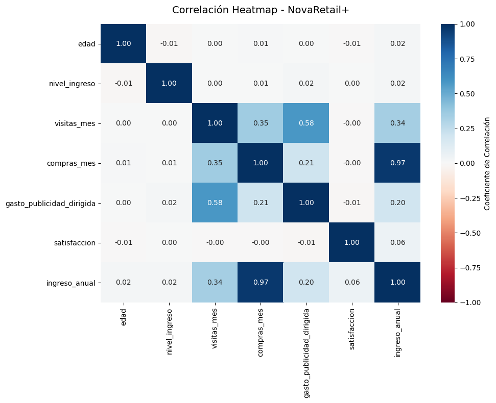
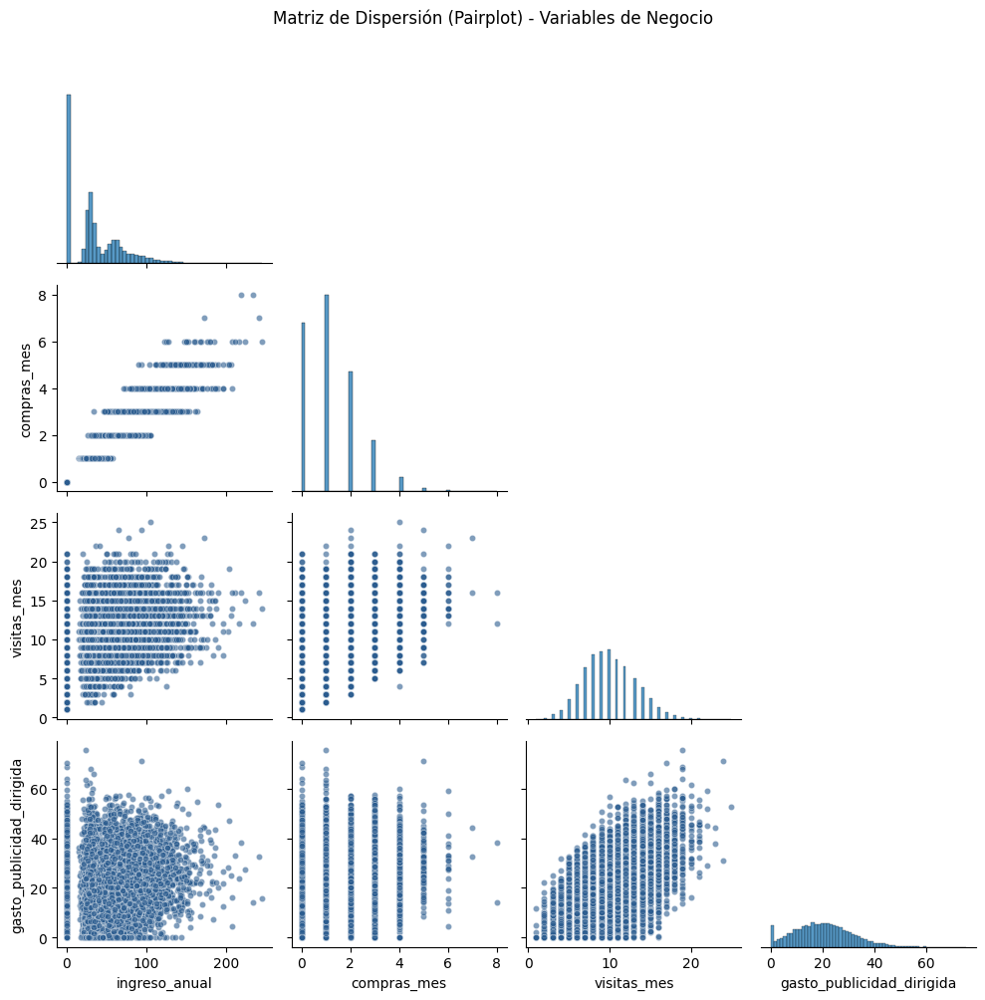
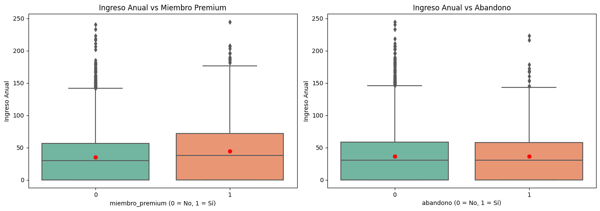

# 🛒 Drivers de comportamiento del cliente: NovaRetail+

Análisis correlacional de 15,000 clientes de una plataforma de e-commerce en Latinoamérica para identificar qué factores de comportamiento están más asociados con el ingreso anual que genera cada cliente.


> **Nota:** proyecto del Bootcamp de Análisis de Datos de TripleTen (2026) con **datos simulados**.



---

## 📌 Resumen en 30 segundos

- **La frecuencia de compra es el principal driver del ingreso:** `compras_mes` tiene una correlación casi perfecta con el ingreso anual (r = 0.97).
- La **publicidad dirigida se asocia más con las visitas (r = 0.58) que con el ingreso (r = 0.20)**: atrae tráfico, pero no necesariamente compras.
- El nivel socioeconómico **no explica el abandono** (r = −0.003, p = 0.73), y la región no se asocia con el dispositivo usado.
- Todo el análisis es **correlacional**: identifica relaciones, no causas.

---

## ❓ Pregunta de negocio

> ¿Qué factores del comportamiento del cliente están más fuertemente asociados con el ingreso anual generado?

---

## 🗂️ Datos

`novaretail_comportamiento_clientes_2024.csv`: **15,000 clientes** y 12 columnas, sin valores nulos.

| Tipo | Variables |
|------|-----------|
| Numéricas | `edad`, `nivel_ingreso`, `visitas_mes`, `compras_mes`, `gasto_publicidad_dirigida`, `satisfaccion`, `ingreso_anual` |
| Binarias | `miembro_premium`, `abandono` |
| Categóricas | `tipo_dispositivo`, `region` |

---

## 🔍 Metodología

Se eligió el coeficiente adecuado según el tipo de variables:

| Tipo de relación | Método |
|------------------|--------|
| Numérica vs numérica | **Pearson** (lineal) y **Spearman** (monótona), comparados entre sí |
| Numérica vs binaria | **Correlación punto-biserial** con prueba de significancia |
| Categórica vs categórica | **Chi-cuadrada** y **V de Cramér** |

Se complementó con mapa de calor, pairplot de variables clave y boxplots. Pearson y Spearman difieren en menos de 0.02 en todos los pares, lo que indica relaciones lineales sin distorsión fuerte por outliers.

---

## 📊 Resultados clave

### Variables numéricas

| Par de variables | Pearson | Spearman | Lectura |
|------------------|---------|----------|---------|
| `compras_mes` vs `ingreso_anual` | 0.97 | 0.97 | Casi perfecta |
| `visitas_mes` vs `gasto_publicidad_dirigida` | 0.58 | 0.56 | Moderada a fuerte |
| `visitas_mes` vs `ingreso_anual` | 0.34 | 0.32 | Moderada |
| `gasto_publicidad_dirigida` vs `ingreso_anual` | 0.20 | 0.18 | Débil |
| `edad`, `nivel_ingreso`, `satisfaccion` vs el resto | −0.01 a 0.06 | | Nula |



### Variables binarias y categóricas



| Hallazgo | Evidencia | Lectura |
|----------|-----------|---------|
| Los miembros premium generan algo más de ingreso | r_pb = 0.093, p < 0.001 (media 44.58 vs 35.30) | Significativa, pero débil |
| El ingreso no se asocia con el abandono | r_pb = −0.003, p = 0.73 (media 36.36 vs 36.64) | Sin relación |
| La región no se asocia con el dispositivo | χ² = 4.60, p = 0.60, V = 0.012 | Independientes (≈65% móvil en todas las regiones) |

---

## 💡 Implicaciones para el negocio

1. **Enfocar crecimiento en la frecuencia de compra** (recompra, suscripciones, recordatorios), que es lo que más se mueve con el ingreso.
2. **Revisar la publicidad dirigida:** genera visitas, pero su relación con el ingreso es débil; conviene medir su conversión a compra antes de aumentar la inversión.
3. **No segmentar la retención por nivel de ingreso:** el abandono parece responder a otros factores (experiencia, atención o engagement) que habría que medir.
4. **Una sola experiencia por dispositivo a nivel nacional:** no hace falta adaptar interfaces por región.

## ⚠️ Limitaciones

- Correlación no implica causalidad.
- Faltan variables que podrían explicar mejor el comportamiento: precio, promociones, antigüedad o contactos con soporte.
- La alta correlación entre `compras_mes` e `ingreso_anual` implica riesgo de multicolinealidad si se usan juntas en un modelo predictivo.

---

## 📁 Estructura del repositorio

```
├── notebooks/
│   └── drivers_comportamiento_novaretail.ipynb   # Análisis completo
├── images/                                       # Gráficas usadas en este README
├── requirements.txt
└── README.md
```

## ▶️ Cómo ejecutarlo

```bash
git clone https://github.com/gaby27lop-jpg/drivers-comportamiento-novaretail.git
cd drivers-comportamiento-novaretail
pip install -r requirements.txt
jupyter notebook notebooks/drivers_comportamiento_novaretail.ipynb
```

El dataset fue proporcionado por la plataforma del bootcamp y no se incluye en el repositorio. El notebook conserva todas las salidas, así que el análisis completo se puede revisar directamente en GitHub.

---

## 👩‍💻 Autora

**Gabriela López Larios**, Analista de Datos

[LinkedIn](https://www.linkedin.com/in/gabrielalopezlarios) · [GitHub](https://github.com/gaby27lop-jpg)
